# KingQuiry
## Property Inquiry and Management System for Kings Land Properties

**A System Development Project**

**Prepared by:**  
ALOCER, BRENT MARC V.  
POLICARPIO, ZYDRYX L.  
RAMOS, JASMINE M.

**Submitted to:**  
College of Informatics and Computing Sciences  
Batangas State University TNEU - ARASOF Nasugbu

**In partial fulfillment of the requirements for:**  
IT 313 - System Analysis and Design

**Target presentation:** December 2026  
**System and source review date:** November 20, 2026  
**Document status:** Technical draft aligned to the repository; client evidence and approvals still require team verification.

> **Evidence and accuracy note.** This report describes the implementation found in the KingQuiry repository on the review date. The supplied template is a PDF and cannot be edited in place. This Markdown file is an editable companion that follows its chapter structure. Mermaid blocks are the diagram source and render in GitHub Markdown or compatible Mermaid viewers. Statements about Kings Land Properties' offline/current business practices, project schedule, approvals, and interview results are not verifiable from application code; they are marked for confirmation rather than presented as measured facts. Do not submit the marked appendices as completed evidence until the team inserts the genuine approved materials.

## Table of Contents

- [1. Business Case](#1-business-case)
  - [1.1 Background of the Project](#11-background-of-the-project)
  - [1.2 Objectives of the Project](#12-objectives-of-the-project)
  - [1.3 Scope and Delimitations](#13-scope-and-delimitations)
  - [1.4 SWOT Analysis](#14-swot-analysis)
  - [1.5 Proposed Work Schedule](#15-proposed-work-schedule)
- [2. System Analysis](#2-system-analysis)
  - [2.1 Existing Process Flow](#21-existing-process-flow)
  - [2.2 Proposed System Flow](#22-proposed-system-flow)
  - [2.3 Context Diagram](#23-context-diagram)
  - [2.4 Level 1 Data Flow Diagram](#24-level-1-data-flow-diagram)
  - [2.5 Use Case Diagram](#25-use-case-diagram)
  - [2.6 Transaction State Flow](#26-transaction-state-flow)
  - [2.7 Inquiry and Viewing Sequence](#27-inquiry-and-viewing-sequence)
  - [2.8 Payment Review Sequence](#28-payment-review-sequence)
- [3. Operational Framework](#3-operational-framework)
  - [3.1 Materials](#31-materials)
  - [3.2 System Design](#32-system-design)
  - [3.3 Security and Data Handling](#33-security-and-data-handling)
  - [3.4 Testing and Verification](#34-testing-and-verification)
- [Appendix 1 - User Manual](#appendix-1---user-manual)
- [Appendix 2 - Approved Request Letter](#appendix-2---approved-request-letter)
- [Appendix 3 - System Screenshots and Demonstration Evidence](#appendix-3---system-screenshots-and-demonstration-evidence)
- [Appendix 4 - Technical Curriculum Vitae](#appendix-4---technical-curriculum-vitae)
- [References](#references)

## List of Tables

1. Objectives and measurable outcomes
2. System scope and delimitations
3. Proposed work schedule
4. Software and technology inventory
5. Database table dictionary
6. Verification cases and recorded results
7. User-role access summary
8. Screenshot register

## List of Figures

1. Existing property inquiry workflow (working baseline to validate)
2. Proposed KingQuiry workflow
3. KingQuiry context diagram
4. Level 1 data flow diagram
5. Proposed system use case diagram
6. Transaction stage state diagram
7. System architecture diagram
8. Entity relationship diagram
9. Client inquiry and viewing sequence
10. Payment submission and verification sequence

# 1. Business Case

## 1.1 Background of the Project

### 1.1.1 Organizational Context

Kings Land Properties is the organization represented by the application. KingQuiry is a web-based property discovery and client-service system. It presents property listings, contact information, buyer guidance, and authenticated services for Clients, Sales Agents, and Administrators. The initial location directory in the fresh-install schema covers municipalities and cities in Batangas, Philippines.

The system provides a shared record of listing data and client requests. Its intended operational value is to help a prospective buyer find an available listing, send a property-specific inquiry or viewing request, and follow the request through staff-managed transaction stages.

### 1.1.2 Existing System or Current Practice

The supplied project template describes property marketing and client coordination outside a single centralized application. The repository does not contain interview transcripts, a signed workflow, or time-and-motion measurements that establish the organization's exact current practice. Therefore, the existing-process diagram in Section 2.1 is a **working baseline** reconstructed from the template narrative and the problems the application addresses. The project team and organization should confirm or replace it using documented interviews or observations before final submission.

The proposed system does not import posts or messages from social media, synchronize an external calendar, or connect to a bank, e-wallet, or payment gateway. Those activities must not be described as automated KingQuiry functions.

### 1.1.3 Identified Problems or Gaps

The system's implemented functions address these operational risks:

1. Listing information, client questions, viewing schedules, and transaction milestones can be difficult to follow when handled in separate records or channels.
2. A prospective buyer needs one place to search listings and inspect their descriptions, category, location, land characteristics, price, and available images.
3. Staff need consistent status changes and a dated transaction history instead of unstructured status text.
4. Client-submitted offline payment reports need review and must remain distinct from verified collections.
5. Managers need actual sales reporting that is based on completed transactions with recorded sale prices, not asking prices or pipeline estimates.
6. Search and filter results should remain visible to the user rather than returning them to an unrelated position on the page.

These are design motivations, not measured findings. Add interview evidence or an approved business-process document if the final academic paper needs quantified problem frequency, financial impact, or response-time comparisons.

### 1.1.4 Need for the Proposed System

KingQuiry provides a shared, role-aware web application for the parts of the property inquiry process that it supports:

- The public catalog presents active listings and preserves search, filter, sort, and pagination choices.
- Registered Clients can submit a property inquiry, request a viewing, review their transaction timeline, chat, and report an offline payment for staff review.
- Sales Agents can manage assigned or available client requests and update permitted viewing and transaction milestones.
- Administrators can manage listings, locations, client accounts, transaction stages, payment records, conversations, and reports.
- Transaction updates are recorded as dated events. A completed sale requires a recorded sale price and sufficient verified payment total.
- The report distinguishes actual recorded sale revenue from the asking-price value of an active pipeline.

The system is an inquiry and transaction-record management application. It is not a property marketplace with automatic title verification, a valuation service, an escrow provider, or a payment processor.

## 1.2 Objectives of the Project

### General Objective

To develop and document a role-based web system that centralizes property discovery, client inquiries and viewing requests, transaction tracking, payment record review, and operational reporting for Kings Land Properties.

### Specific Objectives

| Objective | Observable outcome |
|---|---|
| Present and search property listings | Visitors can search by keyword, category, and location, then sort and paginate the results. |
| Provide listing details | A listing detail page displays its description, asking price, area and price per square meter when available, location, illustrative/credited image, comparable estimate when supported, and inquiry/viewing entry points. |
| Record client requests | An authenticated Client can submit a valid property inquiry or future viewing request. Successful requests create tracking records and can be found from role-appropriate views. |
| Track request progress | Authorized staff can advance a transaction only through an allowed next stage, and the Client can read the dated, client-visible timeline. |
| Coordinate staff work | Sales Agents can view their assigned requests and manage permitted appointment or inquiry work; Administrators can manage the full operational scope. |
| Reconcile payment information | Client payment reports and staff-recorded payments are stored with distinct review statuses and shown in transaction and administrative views. |
| Report actual performance | Administrators can review completed-sale revenue and operational counts without treating asking prices or future years as actual revenue. |
| Protect application actions | Authenticated operations use role checks and request protections such as CSRF checks; account credentials are stored as password hashes. |
| Verify core behavior | The supplied PHP baseline and transaction-record integration checks run without creating permanent fixture records. |

## 1.3 Scope and Delimitations

### In Scope

| Area | Implemented capability |
|---|---|
| Public information | Property catalog, property details, active Sales Agent directory, buyer resources and FAQs, contact links, and shared navigation/theme. |
| Search and discovery | Keyword, property category, and location filters; price/title/date sorting; page-size selection and pagination. |
| Recommendations | Weighted similarity ranking based on listing features. A cold-start result does not claim a match percentage. |
| Property calculator | Calculates an asking price from entered lot area and the listing's price per square meter, then displays a 20% down-payment figure. It is not an independent market valuation. |
| Accounts | Client registration, Client/Agent/Admin role-specific sign-in, session handling, account management, and role-based pages. Registration creates a Client; privileged setup assigns staff roles. |
| Client services | Property inquiries, viewing requests, client notifications, transaction tracking, text chat, and offline payment reports using the supported methods. |
| Agent services | Appointment and inquiry work, inquiry ownership/assignment, and authorized transaction stage updates. |
| Administrative services | Property and location management; client directory; transaction tracking; payments; sales and analytics; customer inbox; and account-status management. |
| Data and reporting | MySQL records for users, locations, listings, appointments, inquiries, chat, transaction events, payments, notifications, and related operational records. |

### Delimitations and Known Limits

1. The application does not process a card, bank transfer, check, cash, or e-wallet payment. A Client can report an offline payment; staff must verify it against the real-world payment evidence and records.
2. Chat replies are produced by an Administrator when available; otherwise, the built-in assistant uses ordered keyword rules and preset responses. It is not an external generative-AI service.
3. Listing estimates are indicative, depend on available listing data, and are not formal appraisals or guarantees of sale price.
4. A listing photo may be an attributed representative image and may not depict the exact property. The user must verify listing details with staff.
5. The map can use approximate municipality-center coordinates when an exact property coordinate is not provided. It must not be treated as a surveyed boundary or exact legal location.
6. The system does not perform legal title searches, certify ownership, calculate all taxes or closing costs, or replace legal, financial, or real-estate professional advice.
7. Public listing content is limited to data entered in KingQuiry. External social-media posts, calendars, and contact channels are not automatically synchronized.
8. The implementation uses a server-rendered PHP application, MySQL/MariaDB, and third-party front-end assets loaded from CDNs. Availability of those assets depends on network access.
9. Detailed Client, Agent, and Admin pages require authorized accounts. The public screenshot appendix does not substitute for authenticated acceptance evidence.
10. The fresh-install schema includes property listings and location reference data but does not create user accounts or business transactions. Any live or production records remain outside this source repository.

## 1.4 SWOT Analysis

This is a project-level analysis of the current implementation, not a market study.

| Strengths | Weaknesses |
|---|---|
| Shared records and role-specific workflows for Clients, Sales Agents, and Administrators. | Some functions depend on accurate staff-entered listing, location, sale-price, and payment data. |
| Dated transaction events and controlled stage transitions improve traceability. | Payment reports represent offline payments and still require manual verification. |
| Prepared database statements, role checks, CSRF protections, password hashing, and rate-limiting support are present in the application. | The built-in chat assistant is rule-based and cannot understand unrestricted language like a general AI model. |
| Report logic distinguishes completed-sale revenue from active pipeline asking prices. | A reliable comparable estimate depends on sufficient, relevant, clean property data. |

| Opportunities | Threats |
|---|---|
| Train staff to maintain consistent property, inquiry, viewing, payment, and transaction records. | Incorrect or outdated listing details may mislead prospective buyers if staff do not verify them. |
| Conduct an authenticated user-acceptance test and use the findings to improve portal workflows. | Unauthorized access, weak hosting configuration, database exposure, or compromised credentials could expose personal information. |
| Add approved real operational data and measure response and completion times with privacy controls. | External CDN, hosting, database, or network outages may reduce availability. |
| Extend integrations only after the organization approves the relevant security and operational requirements. | Treating an estimate, representative image, approximate map pin, or payment report as a verified fact creates business and legal risk. |

## 1.5 Proposed Work Schedule

The template's December 2026 target is retained. The source repository does not establish the team's actual start/end dates or completed-work log, so this is a **relative planning baseline**, not a claim that the activities occurred on these dates. Replace it with the approved team schedule and actual completion evidence.

| Work package | W1 | W2 | W3 | W4 | W5 | W6 | Deliverable |
|---|:---:|:---:|:---:|:---:|:---:|:---:|---|
| Confirm organization process and requirements | X | X |  |  |  |  | Approved requirements and current-process evidence |
| Analyze workflows, roles, data, and constraints |  | X | X |  |  |  | Validated process diagrams and data definitions |
| Design interface, database, and system architecture |  |  | X | X |  |  | Reviewed designs and prototype |
| Implement and integrate system functions |  |  |  | X | X |  | Integrated application |
| Execute tests, correct issues, and conduct acceptance review |  |  |  |  | X | X | Test results and signed acceptance record |
| Finalize report, screenshots, and presentation |  |  |  |  | X | X | Approved documentation package |

# 2. System Analysis

## 2.1 Existing Process Flow

The following is a cautious conceptual reconstruction from the supplied template narrative. **It is not a verified observation of the organization's present process.** Ask the organization to confirm every step, add the actual channels and responsible roles, and replace this diagram if the real workflow differs.

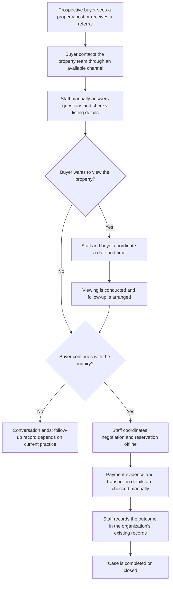

**Validation required:** document which channels, ledgers, calendars, approval steps, payment evidence, and record-retention practices the organization actually uses. Do not state that this diagram was observed unless the team has dated interview or observation evidence.

## 2.2 Proposed System Flow

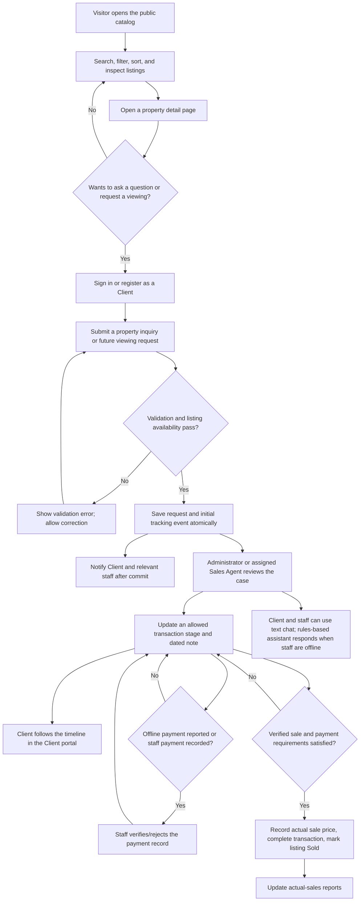

The workflow records information entered by authorized users. It does not itself settle money, validate a legal title, or make an external bank confirmation.

## 2.3 Context Diagram

The database is an internal data store, not an external actor. External parties exchange information with the KingQuiry web application through the browser.

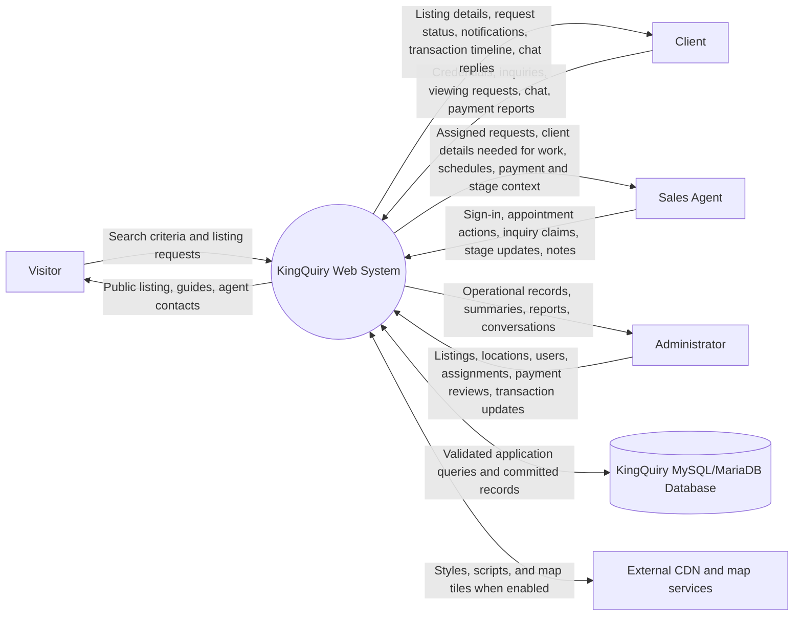

External service note: Bootstrap and related interface assets are loaded from a CDN. Property maps use Leaflet and OpenStreetMap tile attribution where rendered. KingQuiry does not send payment details to a payment gateway.

## 2.4 Level 1 Data Flow Diagram

This DFD decomposes the system into its primary implemented processes and logical stores. A data store does not imply that every field is visible to every role; role checks restrict access.

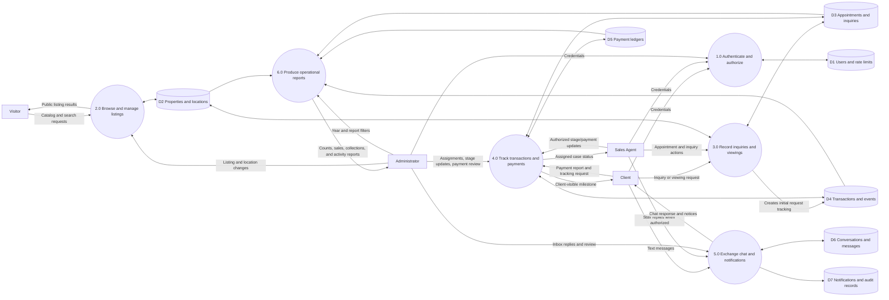

## 2.5 Use Case Diagram

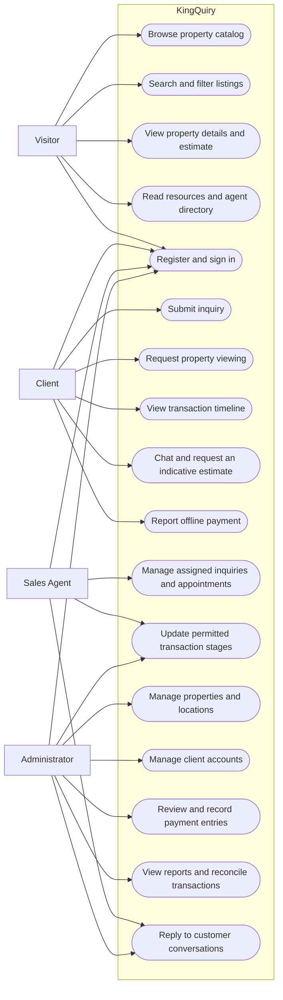

Role details are in Section 3.2.1. A Client has no staff-management privileges; an Agent is scoped to assigned or available work; the Administrator has the administrative modules.

## 2.6 Transaction State Flow

Transaction stage names below are the application's stored values. Appointment status (`Pending`, `Approved`, `Cancelled`) is a separate field and must not be confused with the transaction stage.

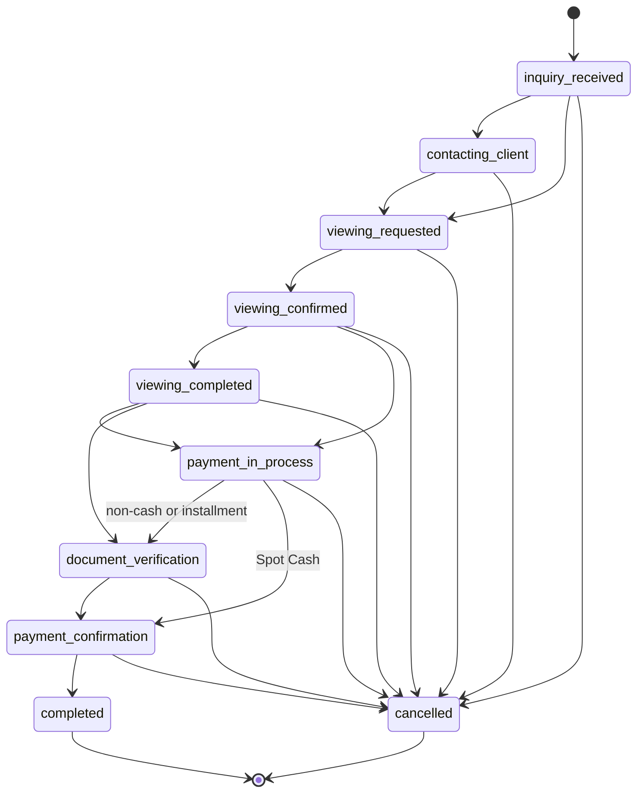

Controls implemented around the flow:

- Only allowed next stages are offered/accepted. A transaction cannot jump directly from payment processing to completion.
- A viewing cannot be approved until an active Sales Agent is assigned to the pending request.
- A completion requires a positive recorded sale price and verified transaction payments that cover that price. Completion marks the property `Sold`.
- Spot Cash can skip the document-verification stage; other payment paths require it before payment confirmation.
- Updates and notes are recorded as transaction events, and client notifications are sent after the database transaction commits.
- New viewing requests must be in the future. Duplicate/overlapping pending or approved viewings for the same property are rejected.

## 2.7 Inquiry and Viewing Sequence

The application validates an authenticated Client request, checks listing availability, and saves the request together with its initial tracking event. A viewing request also checks the requested date/time and conflicting active viewings. Notifications are attempted only after the database commit.

```mermaid
sequenceDiagram
    actor Client
    participant Browser
    participant Detail as Property detail handler
    participant DB as MySQL/MariaDB
    participant Notify as Notification helpers

    Client->>Browser: Submit inquiry or viewing request
    Browser->>Detail: POST with CSRF and one-time token
    Detail->>Detail: Check Client role, token, rate limit, and fields
    Detail->>DB: Begin transaction; lock and recheck listing
    DB-->>Detail: Listing is eligible
    alt Inquiry
        Detail->>DB: Insert inquiry, tracking case, and initial event
    else Viewing request
        Detail->>Detail: Check future date/time and active conflicts
        Detail->>DB: Insert appointment, tracking case, and initial event
    end
    DB-->>Detail: Writes succeed
    Detail->>DB: Commit
    Detail->>Notify: Attempt Client/Agent notifications
    Notify-->>Detail: Notification outcome
    Detail-->>Browser: Redirect after POST with saved status
    Browser-->>Client: Show saved request and tracking entry
    Note over Detail,Notify: A notification failure does not roll back an already committed request.
```

## 2.8 Payment Review Sequence

Client-submitted payment reports and staff-entered payment register entries remain separate records. The following sequence shows the Client-report path; staff must verify the real offline payment before confirming it.

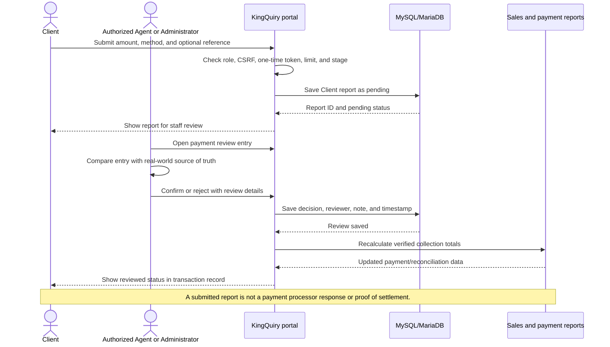

# 3. Operational Framework

## 3.1 Materials

### 3.1.1 Software

| Software or component | Role in KingQuiry | Evidence / qualification |
|---|---|---|
| PHP 8.0 or later | Server-side application and business rules | README requirement; CI runs PHP 8.2. |
| MySQL 8.0 or compatible MariaDB | Relational data storage through `mysqli` | Fresh-install DDL is in `database/schema.sql`. |
| Apache through XAMPP | Local HTTP server for coursework setup | Documented local deployment target. |
| HTML, CSS, JavaScript | Browser interface and client-side interactions | Source in PHP templates, `assets/css/style.css`, and `assets/js/app.js`. |
| Bootstrap 5.3 | Responsive components and layout | Loaded from a CDN by the shared header. |
| Leaflet and OpenStreetMap | Interactive maps and map tiles where configured | Leaflet assets are loaded for map-enabled pages; location accuracy depends on stored coordinates. |
| GitHub Actions | PHP syntax and baseline checks on push/pull request | Workflow: `.github/workflows/php.yml`; PHP 8.2. |
| Current desktop/mobile browser | Client interface | Use a modern browser with JavaScript enabled; the project does not publish a formal cross-browser certification matrix. |

### 3.1.2 Hardware

The repository does not define hosting capacity or a benchmarked concurrent-user limit. For local academic demonstration, use a computer capable of running XAMPP, Apache, MySQL/MariaDB, a modern browser, and the project files. A multi-core processor, at least 4 GB of available memory, and stable network access are practical planning guidance, not measured production requirements.

For hosted use, the organization must select server capacity from a load test and operational needs, protect the database, configure HTTPS and backups, and monitor storage, logs, and availability. Do not treat a developer laptop/XAMPP configuration as production hosting.

## 3.2 System Design

### 3.2.1 Data Design

KingQuiry uses a relational MySQL/MariaDB schema defined for a fresh installation in `database/schema.sql`. The schema contains 18 principal tables. Most business records link to user, property, request, or transaction identifiers using foreign keys. A fresh schema seeds the Batangas location directory and example property listings; it does not seed users, chat histories, requests, payments, or sales.

#### Entity Relationship Diagram

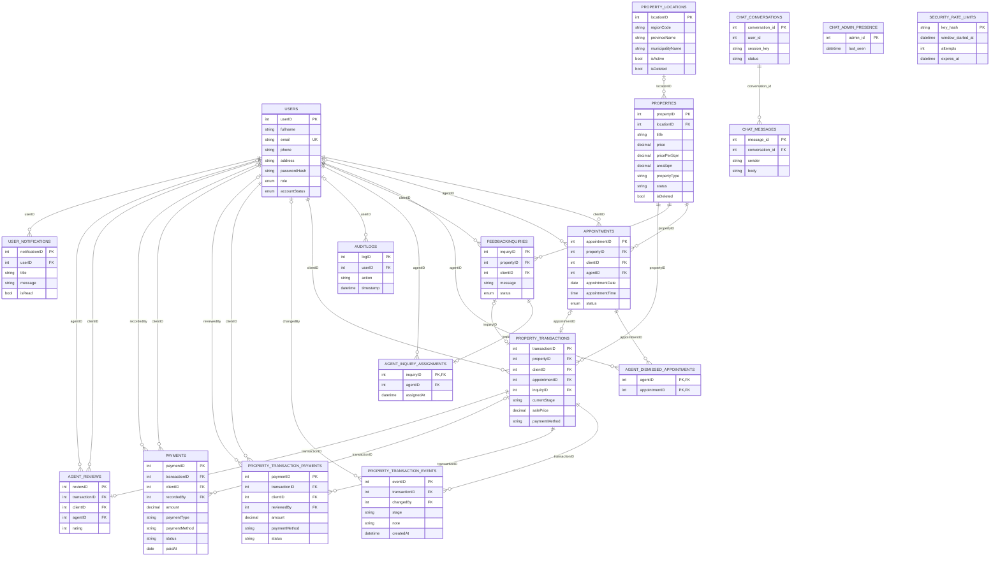

**Relationship notes**

- `property_transactions` associates a property and Client with either a source appointment, an inquiry, or both over the life of a case. Each source reference is unique in the transaction table.
- `property_transaction_payments` stores Client-submitted reports associated with transaction review. `payments` stores staff-entered payment-register records. They are separate ledgers with different review fields; the administrative reports reconcile their relevant records rather than treating a Client report as proof of settlement.
- `agent_reviews` remains in the schema for historical records. The current Client-facing interface does not show the removed feedback prompt.
- `chat_conversations.user_id` and `chat_admin_presence.admin_id` are identifiers, but the schema does not declare every application-level relationship as a foreign key. Do not infer an enforced FK where the DDL does not define one.
- `security_rate_limits` stores keyed request-throttling buckets; it is not a business transaction table.

#### Principal Data Dictionary

| Table | Primary key | Purpose and representative data |
|---|---|---|
| `users` | `userID` | Name, unique email, password hash, role, account status, and optional phone/address. |
| `property_locations` | `locationID` | Region, province, municipality/city, active/deleted flags, and creation time. |
| `properties` | `propertyID` | Listing content, asking price, price per square meter, location, area, type, status, image, optional coordinates, and deletion state. |
| `appointments` | `appointmentID` | Client viewing date/time, property, optional assigned Agent, and `Pending`/`Approved`/`Cancelled` status. |
| `agent_dismissed_appointments` | `agentID`, `appointmentID` | Per-Agent dismissal of appointment items. |
| `feedbackinquiries` | `inquiryID` | Client's property question and `Unread`/`Read`/`Replied` status. The historical table name is retained. |
| `agent_inquiry_assignments` | `inquiryID` | Agent ownership and assignment time for an inquiry. |
| `auditlogs` | `logID` | User-attributed audit action text and timestamp, including successful sign-ins/sign-outs and administrative actions recorded by the application. |
| `chat_conversations` | `conversation_id` | Chat session key, optional signed-in user, status, and timestamps. |
| `chat_messages` | `message_id` | Conversation, sender type (`client`, `admin`, `bot`), message body, and time. |
| `chat_admin_presence` | `admin_id` | Administrator last-seen/heartbeat time used by chat availability behavior. |
| `property_transactions` | `transactionID` | Client/property case, source request, current stage, optional sale price/payment method, and timestamps. |
| `property_transaction_events` | `eventID` | Dated transaction stage/note and optional staff actor. |
| `property_transaction_payments` | `paymentID` | Client-submitted transaction payment report, reference, review status, reviewer, and note. |
| `agent_reviews` | `reviewID` | Historical transaction-linked Agent rating/comment data. Current UI feedback collection is removed. |
| `user_notifications` | `notificationID` | In-app notice, optional link/type, read state, and timestamp. |
| `payments` | `paymentID` | Staff payment register entry: transaction, Client, amount, type, method, reference, status, date, note, and recorder. |
| `security_rate_limits` | `key_hash` | HMAC-keyed request limit bucket, attempt count, time window, and expiry. |

#### Data Rules

- New accounts are Clients. Administrator/Agent accounts must be provisioned by an authorized setup process; the fresh schema does not include credentials.
- Property statuses include `Available`, `Reserved`, and `Sold`; soft-deleted listings are excluded from active catalog/report totals.
- Supported public property types are defined in `includes/property_categories.php` (including Residential, Commercial, Farmlot, Beachlot, Condo, House and Lot, Townhouse, Apartment, Warehouse, Office Space, and Resort). Display labels may differ from stored values.
- A new listing's price per square meter is calculated from total asking price divided by area. Asking price is not recorded revenue.
- Completed transactions store an actual agreed sale price. The sales report groups completed transactions with recorded sale price by completion month and selected year.
- Finalizing a transaction locks and marks its property `Sold` in the same database transaction. Competing open transactions and linked viewings are cancelled and their clients are notified. Sold properties are excluded from public listings and new requests; only Administrators can see the `Sold` status, while other users receive a generic unavailable response. An administrator cannot relist a sold property.
- A future report year is an empty actuals view, not a forecast.
- The Client report ledger and the staff payment register are distinct. Pending/rejected submissions are not verified collections.

### 3.2.2 System Architecture

KingQuiry is a server-rendered PHP application. PHP page controllers and shared `includes/` helpers validate requests, enforce roles, query MySQL through `mysqli`, and render HTML. The browser runs JavaScript for interactions such as menu behavior, forms, chat polling, maps, and calculators. The repository does not implement a separate REST microservice or a general-purpose MVC framework.

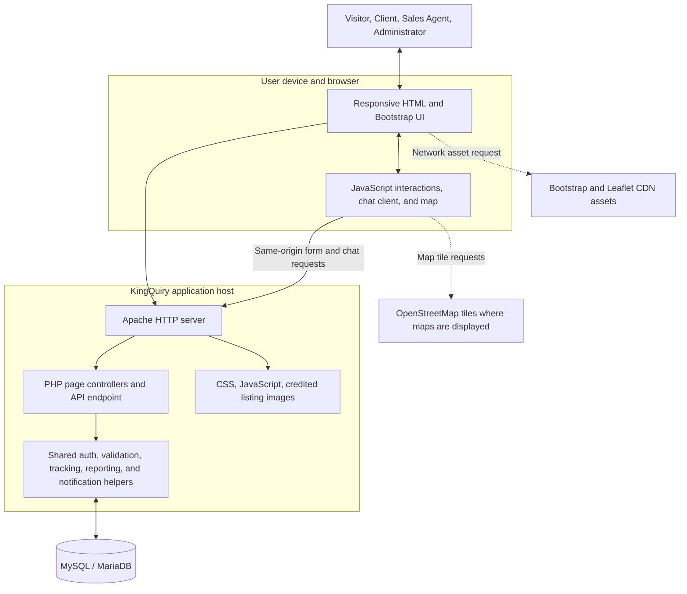

**Architecture boundaries**

- Request handling and business rules run on the application server; the browser is not trusted to enforce authorization or data integrity.
- `config/db.php` configures the MySQL connection and environment-specific schema behavior.
- `includes/` contains shared authentication, role, notification, location, property image, estimator, analytics, and transaction logic.
- `chat_api.php` provides the same-origin chat operations. It stores messages and can return a rule-based response; it does not call an external AI API.
- The front-end uses CDN-hosted Bootstrap and map libraries; local operation of the full interface may require Internet access.
- The application has a production mode that refuses default insecure database credentials and missing rate-limit configuration and does not initialize schema from a web request. Existing database changes must be reviewed and backed up before deployment.

## 3.3 Security and Data Handling

Security mechanisms observed in the code include:

- PHP password hashing and password verification for credentials.
- Session ID regeneration after successful sign-in; HTTP-only and SameSite cookie settings; URL-based session IDs disabled.
- Role checks for Client, Agent, and Admin pages/actions.
- CSRF tokens on protected form and chat operations.
- Prepared statements for database queries involving request values.
- HMAC-keyed rate-limiting buckets for authentication and selected customer-facing requests.
- Output escaping for user- or database-sourced text rendered in HTML.
- Transactional request and stage updates where the business operation requires coordinated database writes.
- Secure response headers, including anti-framing, no-sniff, and referrer-policy headers.

Deployment safeguards and limitations:

1. Use HTTPS, least-privilege database credentials, a protected secret of at least 32 characters for production rate limits, off-site backups, log monitoring, and tested restoration.
2. Never commit credentials, a production database dump, personal client records, payment references, or uploaded files without approval and a privacy review.
3. Restrict direct web access to configuration, database, test, and source-helper directories using the supplied server rules.
4. The code includes inline scripts/styles and does not claim that its response headers alone constitute complete production hardening. Review the current `.htaccess`, host configuration, CSP needs, privacy notices, retention policy, and incident-response plan before public deployment.
5. No payment is considered settled only because a Client submitted a report. A staff member must verify the record against the organization's source of truth.

## 3.4 Testing and Verification

### Recorded Automated Checks

The following checks were run against the reviewed workspace on November 20, 2026:

| Check | Command / evidence | Result |
|---|---|---|
| PHP syntax for the changed/reporting and transaction test files | `php -l` on the applicable PHP files | Passed; no syntax errors. |
| Production baseline and business-rule assertions | `php tests/production_baseline_test.php` | Passed. |
| Inquiry/viewing, assignment, portal visibility, payment review, and cross-ledger integration checks | `php tests/transaction_records_test.php` | Passed. |
| Whitespace/error check | `git diff --check` | Passed for the reviewed changes. |
| Local visual evidence | Screenshots listed in Appendix 3 | Captured from the local application on November 20, 2026; public pages and sign-in/registration screens only. |

The transaction integration test uses connection-scoped temporary tables. Its test fixture data is discarded with the connection; it does not add permanent Client, inquiry, payment, or transaction records to the application database. The local PHP CLI also emitted a duplicate OpenSSL-module-load warning during test startup; the tests themselves passed. That environment warning is not represented as an application test failure.

### Verification Cases

| ID | Scenario | Expected behavior | Recorded outcome |
|---|---|---|---|
| T-01 | Use a valid future viewing date/time | Accept the future time; reject past, current-minute, invalid calendar date, or invalid time | Covered by production baseline checks; passed. |
| T-02 | Attempt to skip required transaction stages | Reject an invalid direct transition | Covered by production baseline checks; passed. |
| T-03 | Continue a Spot Cash path | Allow Spot Cash to go from payment processing to payment confirmation without document verification | Covered by production baseline checks; passed. |
| T-04 | Select a supported payment method | Accept Cash, Bank Transfer, and Check for Client reports; reject unsupported GCash | Covered by production baseline checks; passed. |
| T-05 | Create inquiry- and viewing-linked cases | Store and expose the case to the appropriate Client/Admin/assigned Agent views | Covered by transaction integration checks; passed. |
| T-06 | Claim an unassigned inquiry | Make it visible to the claiming Agent; prevent another Agent from taking an already assigned inquiry | Covered by transaction integration checks; passed. |
| T-07 | Report the same Client payment reference twice | Reject the duplicate report | Covered by transaction integration checks; passed. |
| T-08 | Confirm or reject a Client payment report | Apply the selected review state and calculate the relevant ledger totals | Covered by transaction integration checks; passed. |
| T-09 | Generate annual sales report years | Include recorded years, current year, and five future years without duplicates; show future years as actuals-only | Covered by production baseline checks; passed. |
| T-10 | Open public catalog, search/filter/sort, details, guidance, sign-in, and registration pages | Render the expected public interfaces | Manually captured in Appendix 3; no automated end-to-end assertion is claimed. |

### Further Acceptance Testing Required

- Run the Client, Agent, and Admin acceptance scenarios using organization-approved test accounts.
- Verify each portal's authorization boundary and role-specific record visibility using non-production test data.
- Review listing accuracy, legal disclaimers, payment verification procedure, notification delivery, and the full transaction lifecycle with the organization.
- Test browser/device responsiveness, keyboard accessibility, backup/restore, production TLS, and concurrent-user performance in the target hosting environment.
- Obtain sign-off for the existing-process diagram, requirements, data retention, and any production rollout.

# Appendix 1 - User Manual

## A. Visitor: Find a Property

1. Open the KingQuiry home/catalog page.
2. Search by keyword or choose the category and location filters.
3. Select a sort order and page-size option. The results are displayed in the catalog results area.
4. Open **View property details** to inspect the listing, price, area, location, description, photo credit, and map information.
5. Treat any comparable estimate as indicative only. A representative image or approximate map pin is not proof of the exact property's condition or boundary.
6. Read **Resources & Guides** and contact staff using the available contact details for information requiring verification.

## B. Client: Register, Request, and Track

1. Create an account with the registration page. New self-registered accounts receive the Client role.
2. Sign in through the Client sign-in page.
3. From an available property detail page, submit an inquiry or request a future viewing. Correct any validation message and resubmit.
4. A saved inquiry/viewing receives a tracking record. Open the Client dashboard and its transaction/tracking area to check the latest stage, notes, and timeline.
5. Use the chat bubble to send a text message. When staff are offline, the built-in assistant may return a preset response. The chat is text-only; it is not a secure file-upload or payment-receipt channel.
6. If a real-world offline payment was made, submit a payment report using the supported method and reference fields. This is a report for staff review, not a payment or confirmation.
7. Wait for the organization's staff to verify the payment. Do not treat a pending report or chatbot response as proof of settlement.
8. Manage account information or sign out using the shared account menu.

## C. Sales Agent: Handle Assigned Work

1. Sign in through the Sales Agent portal using an account provisioned by the administrator.
2. Review assigned/available inquiries and viewing requests.
3. Claim an unassigned inquiry when appropriate; an inquiry already assigned to another Agent cannot be claimed.
4. Review the property's request, Client, and viewing details. Update appointment status only when the workflow permits.
5. Use Transaction Tracking to advance an authorized case by one permitted stage at a time and add an accurate note.
6. Record/confirm payment details only when supported by the organization's verification process and the application permits the current stage.
7. Do not mark a sale complete until the actual sale price and required verified-payment conditions have been checked.

## D. Administrator: Maintain and Review the System

1. Sign in through the Admin portal. The fresh schema contains no administrator account.
2. For a local first install, register the intended administrator account and have the database owner assign its role through an approved, scoped setup operation. Confirm exactly one account was updated. Do not use shared or default production credentials.
3. Use the Admin dashboard to manage property listings, listing status, locations, and overview tasks.
4. Use **Clients** to search and maintain Client accounts and account status.
5. Use **Reports & Analytics** to review actual completed-sale revenue and other activity. Choose a year; future years display actual data only and are not forecasts.
6. Use **Sales & Transactions** and **Transaction Tracking** to review a case, assignment, stage, event history, sale price, and outstanding amount.
7. Use **Payments** to record staff payments and review Client reports. Verify actual offline payment evidence before confirming a report.
8. Use **Client Inbox** to review conversations and reply when the Administrator is active.
9. Keep an auditable operational process outside the application for tasks that KingQuiry does not perform, including title verification, actual fund settlement, statutory fees, and legal approvals.
10. Sign out after administrative work, especially on a shared device.

## E. Transaction and Payment Terms

- **Inquiry received:** a Client's property question is tracked.
- **Viewing requested/approved/completed:** a viewing request is scheduled, assigned, and progressed.
- **Payment in process:** staff coordinate payment terms and applicable paperwork.
- **Document verification:** staff verify the transaction documents for applicable payment paths.
- **Payment confirmation:** staff confirm that the required verified payment record exists.
- **Successful/completed:** the actual sale price is saved, verified payments cover the recorded sale price, and the property is marked Sold.
- **Cancelled:** the case is closed as cancelled and cannot advance further.
- **DOAS / CTS:** the system's documented business rules distinguish Spot Cash from installment paths. The application does not produce or legally validate these documents.
- **Seven-day reservation guidance and buyer-cost disclosures:** use the current on-screen disclosure and organization policy; do not treat interface text as a substitute for signed agreements or legal advice.

# Appendix 2 - Approved Request Letter

**Not included in the repository.** Insert a scan or approved electronic copy of the actual signed request/permission letter here. Confirm that it identifies the organization, purpose, date, authorized signatories, and any restrictions on screenshots or sample data. Do not create or reproduce signatures.

## Required evidence checklist

- [ ] Authorized organization representative approved the project/data use.
- [ ] Letter is signed and dated by the actual signatories.
- [ ] Name/title and contact details are approved for academic submission.
- [ ] Any personal or confidential details not needed for the submission are redacted with approval.

# Appendix 3 - System Screenshots and Demonstration Evidence

The following 12 screenshots were captured from the local KingQuiry application on November 20, 2026. They document public catalog, search/filter/sort states, listing details, guidance, directory, sign-in/registration pages, and the customer chat bubble. These screenshots do **not** show authenticated Client, Sales Agent, or Admin dashboards. Add screenshots of those portals only after logging in with organization-approved non-production test accounts; redact personal data and payment references.

| Figure | Screenshot | Description |
|---|---|---|
| A3-1 |  | Public property catalog. |
| A3-2 |  | Catalog with keyword search query. |
| A3-3 | 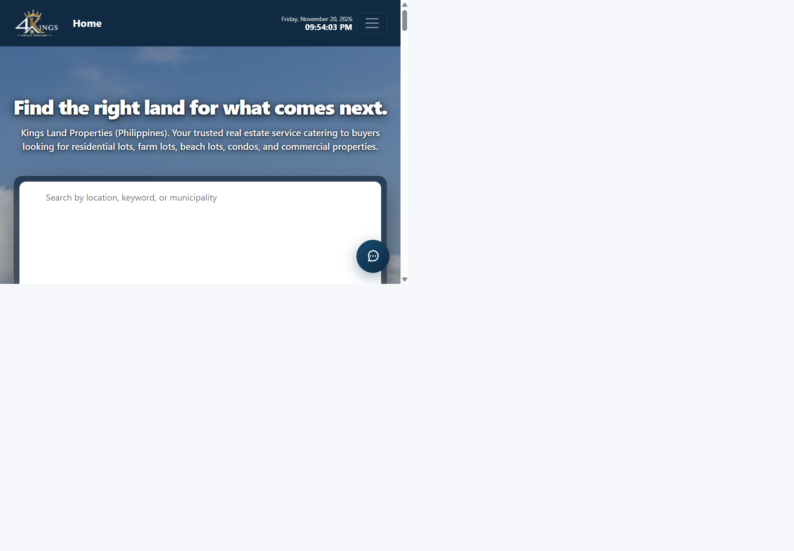 | Catalog with a category filter. |
| A3-4 |  | Catalog with price sort selected. |
| A3-5 | 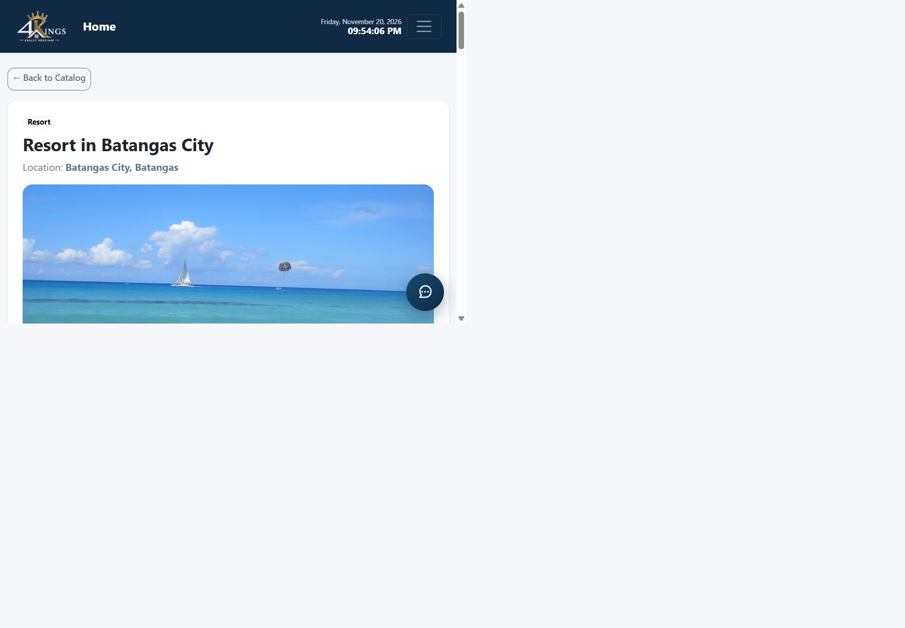 | Property detail, comparable estimate, calculator, and visitor action area. |
| A3-6 | 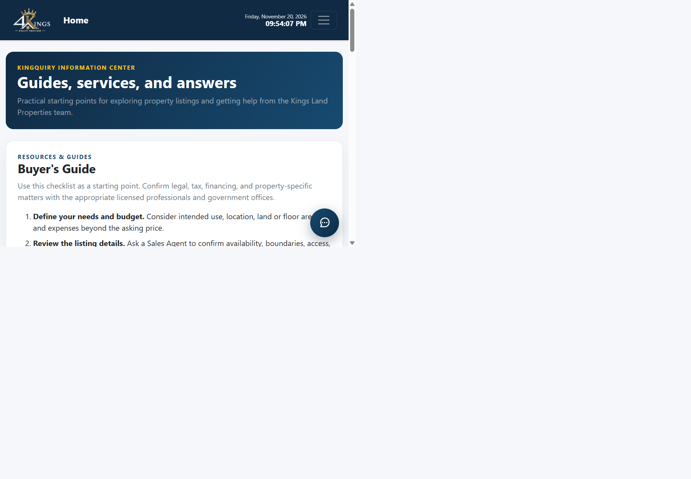 | Public buyer resources and guides. |
| A3-7 | 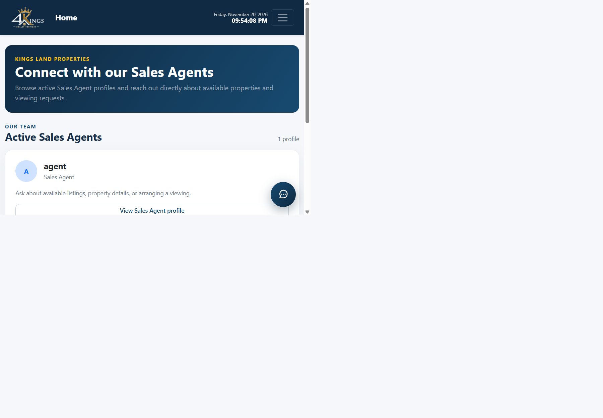 | Public Agent directory. |
| A3-8 |  | Client sign-in page. |
| A3-9 | 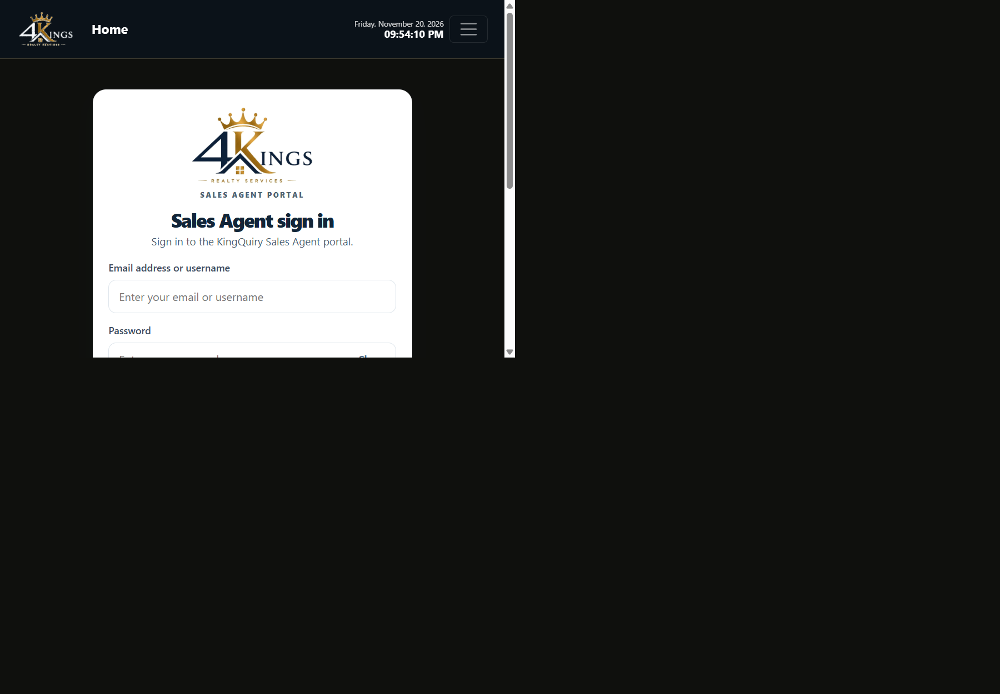 | Sales Agent sign-in page. |
| A3-10 |  | Administrator sign-in page. |
| A3-11 |  | Client account registration form. |
| A3-12 | 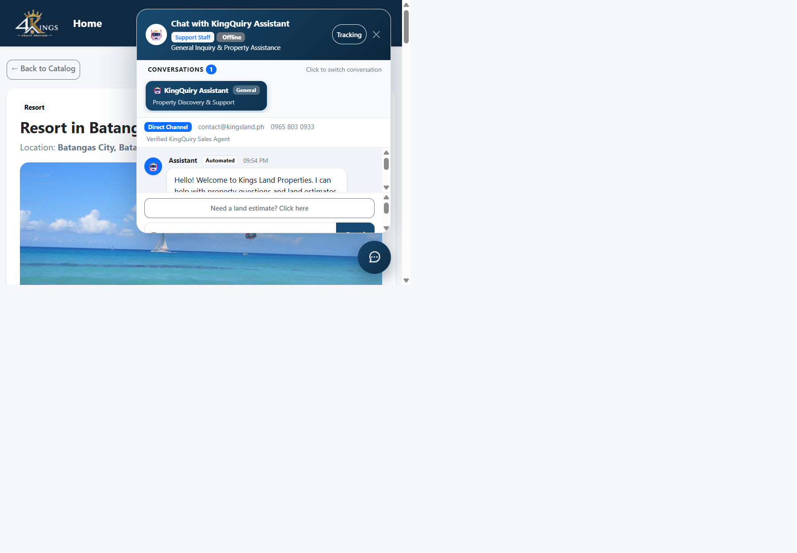 | Customer chat bubble and available text-only assistant. |

### Additional authenticated screenshots to collect

Capture at least one representative screen from each role and redact names, email addresses, phone numbers, transaction references, exact private addresses, and payment notes:

1. Client dashboard summary and tracking timeline.
2. Client inquiry/viewing record and status.
3. Client payment report status (use a test payment, not a real reference).
4. Sales Agent dashboard with test inquiry and viewing assignments.
5. Sales Agent transaction-stage update form.
6. Admin dashboard and property/location management.
7. Admin Reports & Analytics year selector and chart.
8. Admin Payments review screen.
9. Admin Sales & Transactions register/reconciliation.
10. Admin Client Inbox.

Do not populate the production database merely to produce screenshots. Use isolated test data or an approved demonstration environment, then record which environment and test date were used.

# Appendix 4 - Technical Curriculum Vitae

The supplied template reserves this appendix for team-member CVs. Keep each member's approved CV in the final school submission package. This repository copy intentionally does not reproduce home addresses, private phone numbers, personal references, or other unnecessary CV data.

## Required evidence checklist

- [ ] Insert the actual, current CV for each listed team member.
- [ ] Obtain each member's consent to include personal information.
- [ ] Remove personal data not requested by the school.
- [ ] Verify educational and employment information before submission.

# References

## Project artifacts reviewed

- KingQuiry application source and role-specific PHP pages in this repository.
- `database/schema.sql` - fresh-install relational schema and reference/property data.
- `includes/transaction_tracking.php` - transaction stage and payment business rules.
- `includes/ml_recommender.php` - property recommendation ranking.
- `includes/admin_analytics.php` and `admin_reports.php` - annual actual-sales reporting.
- `tests/production_baseline_test.php` - baseline assertions.
- `tests/transaction_records_test.php` - isolated transaction/payment integration checks.
- `README.md` and `CHANGELOG.md` - setup and dated implementation notes.

## Technical references

- PHP Manual, Password Hashing: <https://www.php.net/manual/en/book.password.php>
- PHP Manual, MySQLi: <https://www.php.net/manual/en/book.mysqli.php>
- MySQL Reference Manual, InnoDB: <https://dev.mysql.com/doc/refman/8.0/en/innodb-introduction.html>
- Bootstrap Documentation: <https://getbootstrap.com/docs/5.3/>
- Leaflet Documentation: <https://leafletjs.com/reference.html>
- OpenStreetMap Copyright and Attribution: <https://www.openstreetmap.org/copyright>

## Final review before academic submission

- [ ] Organization and current-process narrative approved by the organization.
- [ ] Existing-process diagram validated against an actual interview/observation.
- [ ] Objectives and scope approved by the adviser and project stakeholder.
- [ ] Proposed schedule replaced with the team's actual approved dates.
- [ ] Authenticated Client, Sales Agent, and Admin screenshots added using approved test accounts.
- [ ] Signed request letter and permitted interview/demo evidence inserted.
- [ ] CVs checked for consent and unnecessary personal data removed.
- [ ] Table of contents, figure list, table list, page numbering, and final PDF refreshed after Word/Markdown conversion.
- [ ] All source paths, feature names, screen labels, and test results rechecked against the deployed version used for the demonstration.
